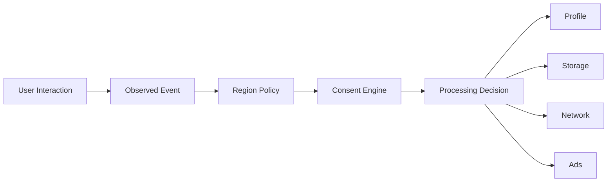
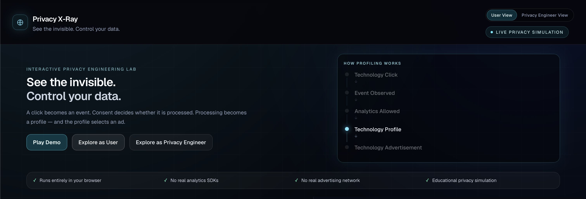
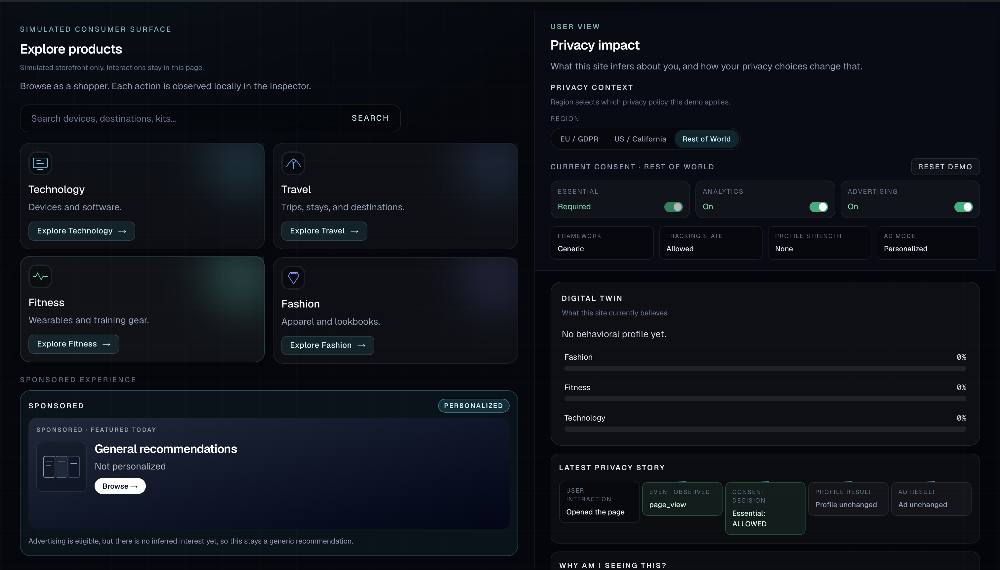
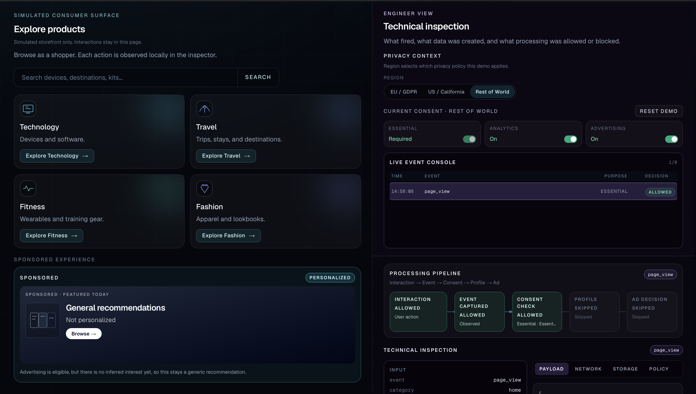
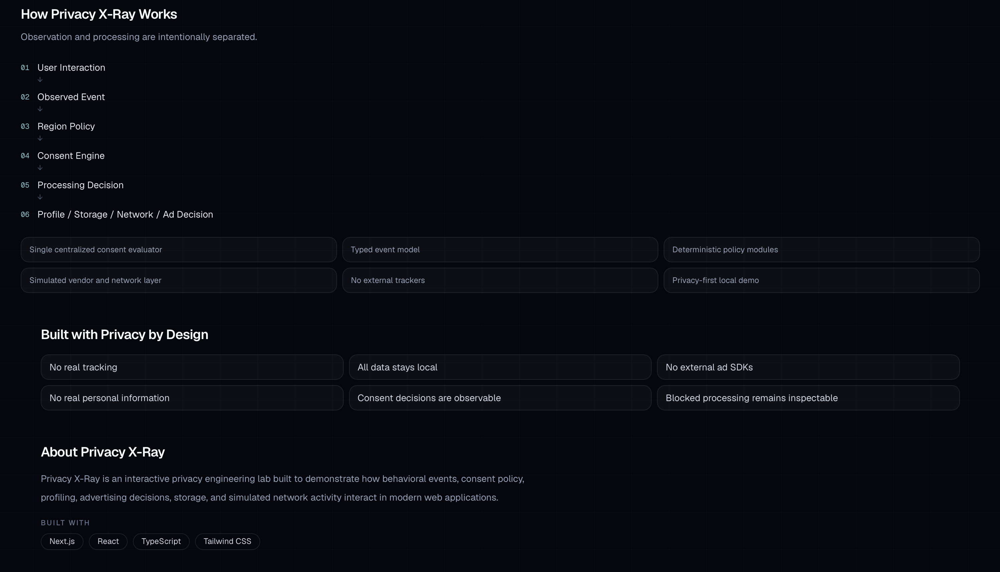

# Privacy X-Ray

> Interactive Privacy Engineering Lab demonstrating how modern websites capture events, evaluate consent, build behavioral profiles, and personalize user experiences.

🌐 **Live Demo:** https://privacy-xray.vercel.app

> Educational simulation only — not a production CMP or legal/compliance implementation.

---

## Features

- ✅ Interactive privacy simulation
- ✅ Region-aware privacy simulation (EU / US / Rest of World).
- ✅ User View & Privacy Engineer View
- ✅ Live consent processing pipeline
- ✅ Behavioral profile visualization (Digital Twin)
- ✅ Simulated network, storage & vendor activity
- ✅ Privacy-first architecture with no real tracking

## What is Privacy X-Ray?

Privacy X-Ray is a local demo of how ordinary user actions become observed events, how region-aware consent policy decides what processing is allowed, and how those decisions show up as profile updates, simulated storage writes, simulated network requests, and personalized or contextual ads.

It is built for recruiters and engineers who want to see the path between a click and a downstream privacy outcome.

## Why I built it

Tracking is normally invisible. Consent banners show choices, but they rarely show what happens next: which events were observed, which purposes were gated, whether a profile changed, and whether an ad slot stayed contextual.

The goal of this project is to make privacy processing observable. Observation and processing are separate on purpose. A blocked event still appears in the inspector; analytics, profiling, storage, and advertising simply do not run.

## Core concepts demonstrated

- **Event observation** — page views, category views, product clicks, search, consent, and region changes
- **Consent gating** — Essential, Analytics, and Advertising purposes
- **Region-aware privacy policy** — EU opt-in, US / California opt-out, Rest of World
- **Behavioral profiling** — inferred interests only from Analytics-allowed events
- **Personalized vs contextual advertising** — ad creatives switch with consent and profile
- **Storage decisions** — simulated writes that never touch `localStorage` or cookies
- **Simulated network requests** — vendor-style destinations with no real `fetch()`
- **Vendor decisions** — allow, block, or skip based on purpose and consent
- **Privacy violation detection** — flags a simulated request that conflicts with policy

## User View

User View focuses on **consequences**:

- Digital Twin of inferred interests
- profile changes after allowed vs blocked events
- ad personalization vs contextual fallback
- privacy choices (region, consent, Do Not Sell or Share)

## Privacy Engineer View

Engineer View focuses on **mechanism**:

- live event console
- payload inspection
- policy decision and Privacy Signal
- network and storage outcomes
- processing pipeline
- violation detection

Engineer View is intentionally longer, especially on mobile, because it exposes the full processing path.

## Regions

These are **educational simulations**, not legal or compliance implementations. They do not implement GDPR, CCPA/CPRA, TCF, GPP, or a production CMP.

- **EU / GDPR-style opt-in demo** — Analytics and Advertising start off until the user opts in
- **US / California-style opt-out demo** — processing can start allowed; Do Not Sell or Share blocks personalized advertising
- **Rest of World generic demo** — a simple default used for walkthroughs and Play Demo

## Architecture



## Privacy by Design

- no real analytics SDKs
- no real advertising SDKs
- no real personal data
- no external data transmission
- simulation runs locally in browser state

The demo also does not use cookies, `localStorage`, geo-IP, or real vendor tags. The **Privacy Signal** shown in Engineer View is a local JSON object, not a TCF or GPP string.

## Tech Stack

- Next.js
- React
- TypeScript
- Tailwind CSS

## Running locally

```bash
npm install
npm run dev
```

Open [http://localhost:3000](http://localhost:3000).


## Validation

```bash
npm run lint
npm run build
```

No environment variables are required.

## Demo scenarios

**Technology profiling.** Stay in Rest of World with Analytics and Advertising on. Open Technology. The Digital Twin shifts toward Technology and the ad creative becomes a technology placement.

**Analytics blocked.** Turn Analytics off and open Travel. The event is still observed. The pipeline stops at consent. The profile does not change.

**Advertising off.** Disable Advertising. The ad experience stays contextual even if a profile already exists.

**EU opt-in.** Switch to EU / GDPR. Analytics and Advertising start off. A Technology click is observed but not processed until the user opts in.

**US Do Not Sell or Share.** Switch to US / California. Enable Do Not Sell or Share. Personalized advertising is blocked; contextual ads remain.

**Simulated violation.** In Engineer View, use Simulate privacy violation. If Advertising is not allowed, the detector flags a simulated SENT request that should have been blocked. Nothing is transmitted off-device.

## Project screenshots

### Hero Experience

The landing page introduces the privacy simulation and explains how a simple user interaction becomes an event, profile, and personalized advertisement.



---

### User View

See how user interactions build an inferred interest profile, influence personalization, and change the simulated advertisement based on consent.



---

### Privacy Engineer View

Inspect the complete processing pipeline including captured events, consent evaluation, payloads, storage, simulated network requests, and policy decisions.



---

### Architecture & Privacy by Design

A high-level overview of the event lifecycle together with the design principles used throughout the demo.



---

## Future ideas

- standards lab for real TCF/GPP decoding
- CMP sandbox integration
- automated Playwright privacy tests
- privacy scanner integration
